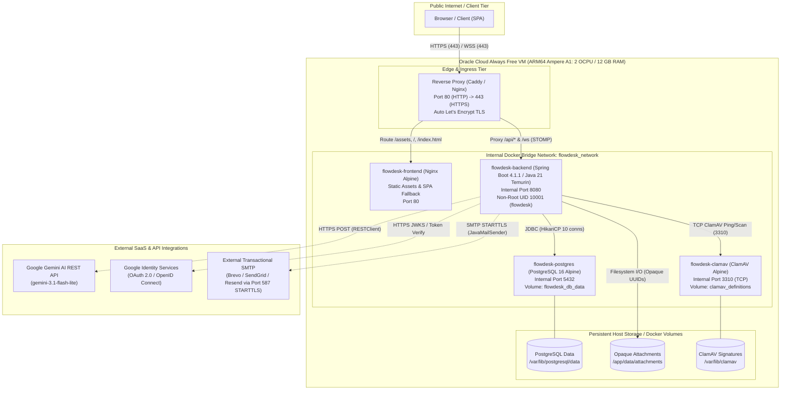
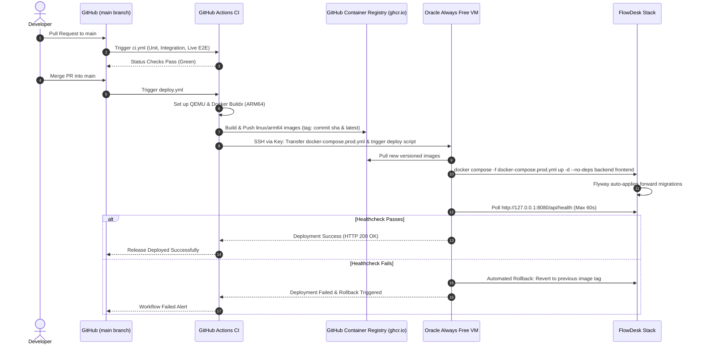

# FlowDesk Day 65 — SRE & Free Cloud Deployment Readiness Audit

**Report Date:** November 3, 2026  
**Repository:** `C:\Users\gvibh\Projects\flowdesk`  
**Working Audit Branch:** `audit/day65-sre-deployment-readiness`  
**Target Environment:** Oracle Cloud Infrastructure (OCI) Always Free — ARM64 Ampere A1 VM (2 OCPU / 12 GB RAM)  
**CI/CD Target:** Automated GitHub Actions Pipeline with Multi-Arch Build & SSH Deployment  
**Audit Status:** Complete  
**Overall Verdict:** **CONDITIONAL GO** (Clear architectural fit; requires addressing 5 specific SRE/operational prerequisites prior to live cutover)

---

## 1. Current Merged Git Baseline

- **Repository Root:** `C:\Users\gvibh\Projects\flowdesk`
- **Active Branch:** `audit/day65-sre-deployment-readiness` (created from updated `main`)
- **Verified Main Commit:** `b44e962`
- **Upstream PR Context:** Day 64 PR #57 (*FlowDesk Horizon Enterprise UI/UX Redesign & Release Candidate*) merged cleanly into `origin/main`.
- **Flyway Database Version:** V25 (`backend/src/main/resources/db/migration/V25__add_ticket_comment_visibility.sql`).
- **Local Workspace Safety:** Local maintenance scripts (`repair_postgres.bat`, `db_test_setup.bat`) and scratch directories preserved intact; zero uncommitted production changes overwritten.

---

## 1b. Corrected Audit Assumptions & SRE Revisions (November 3, 2026)

Following rigorous operational review, the following audit assumptions are formally refined and preserved for Day 65/66 planning:

1. **OCI Always Free A1 Monthly Compute Allowance:**
   - *Previous note:* Raw theoretical quota of 4 OCPU / 24 GB RAM.
   - *Refined Correction:* The actual OCI Always Free allowance for Ampere A1 compute is **1,500 OCPU-hours and 9,000 GB-hours per month**. When operated continuously 24/7 (~720–744 hours/month), this allowance supports an allocation of approximately **2 OCPU and 12 GB RAM**. Sizing above 2 OCPU / 12 GB continuously would exhaust monthly free-tier allowances and incur billing.
2. **Memory Footprint Rigor:**
   - Architectural memory estimates (~4.6 GB active RSS across all containers) are modeled from component configurations and JVM settings.
   - *Refined Correction:* All memory numbers must be treated as **unverified estimates** until empirical measurements are gathered under real-stack runtime workloads in Day 66.
3. **Pay-As-You-Go (PAYG) Upgrade Risks:**
   - Previous mitigation suggested upgrading to PAYG to eliminate idle instance reclamation.
   - *Refined Correction:* A PAYG upgrade **must not be treated as a zero-cost guarantee**. While Always Free resource consumption remains $0.00 if strictly bounded, any accidental over-provisioning (e.g. egress >10 TB, extra block volumes, boot volume resizing >200 GB, or external billable API usage) will automatically charge the credit card on file without a hard budget cap.
4. **Provider Free-Tier Volatility:**
   - Free cloud quotas across all providers (Oracle, Google AI Studio, Brevo, GitHub Container Registry) are **not guaranteed to remain permanent**. Terms of service, rate limits, and resource quotas can change with minimal notice. Architecture must remain strictly portable (standard Docker Compose) to enable immediate migration if terms change.
5. **Disaster Recovery: Same-Host vs Off-Host Storage:**
   - Storing database dumps and attachment tarballs on the VM host (`/opt/flowdesk/backups`) provides protection against application corruption or bad migrations, but **fails completely** if the VM is terminated, block volume corrupted, or tenancy locked.
   - *Refined Correction:* Same-host backups must be distinguished from true off-host disaster recovery (DR). True DR requires off-host replication (e.g. encrypted push to external object storage or remote repository).
6. **Real Deployment Limitations & Failure Modes:**
   - Single-node architecture means zero redundancy during host maintenance or reboot. Downtime is expected during kernel updates or VM failovers.

---

## 2. Architecture and Dependency Diagram

The diagram below reflects the **actual running code contracts** verified in the repository. Notably, Redis is completely absent; distributed synchronization is handled via PostgreSQL ShedLock.



---

## 3. Component Inventory

| Component | Repository Implementation | Mandatory / Optional / Dev-Only | Evidence & Notes |
| :--- | :--- | :--- | :--- |
| **Backend Framework** | Spring Boot 4.1.1, Spring Framework 7.x | **Mandatory** | `backend/pom.xml:18-22`. Standalone executable JAR running on Java 21. |
| **Java Runtime** | Eclipse Temurin JDK 21 (Alpine) | **Mandatory** | `backend/Dockerfile:3,26`. Multi-stage build with `eclipse-temurin:21-jre-alpine`. |
| **Frontend Framework** | React 19, TypeScript 5.8, Vite 6.2, TailwindCSS 4 | **Mandatory** | `frontend/package.json:14-25`. Single-page application. |
| **Frontend Web Server** | Nginx Alpine (Reverse Proxy / Static File Server) | **Mandatory** | `frontend/Dockerfile:32`, `frontend/nginx.conf`. Proxies `/api/` and `/ws` to backend. |
| **Database Engine** | PostgreSQL 16 (Alpine in Docker) | **Mandatory** | `docker-compose.yml:7`. HikariCP max pool 10 (`application.properties:8`). |
| **Database Migrations** | Flyway Community (V1 to V25) | **Mandatory** | `backend/pom.xml:65`, `backend/src/main/resources/db/migration/`. Automatically applied on boot. |
| **Redis** | **0% Present / Not Used** | **NOT REQUIRED** | Verified: ShedLock handles locking via PostgreSQL; rate limiting is in-memory; WebSocket broker is in-memory. Zero Redis overhead. |
| **WebSocket / STOMP** | Spring WebSocket + In-Memory SimpleBroker (`/queue`) | **Mandatory** | `WebSocketConfig.java:16,72`. Private notification routing (`/user/queue/notifications`). |
| **Attachment Storage** | `LocalDiskAttachmentStorageService` | **Mandatory** | `LocalDiskAttachmentStorageService.java:31`. Files stored as opaque UUIDs (`.dat`), mapped to persistent volume. |
| **Malware Scanner** | `ClamAvMalwareScanner` (TCP 3310) | **Mandatory in Prod** | `MalwareScannerConfig.java:28`. Production profile strictly rejects mock/test scanners (fails closed). |
| **Email Delivery** | `SmtpEmailSender` / `JavaMailSenderImpl` | **Mandatory** (for invites/resets) | `EmailConfig.java:19-51`. Connects via port 587 (STARTTLS). Mailpit is dev-only. |
| **Google OAuth** | `GoogleAuthService` & `GoogleTokenVerifier` | **Optional** | `GoogleOAuthProperties.java`. Enabled via `GOOGLE_OAUTH_ENABLED=true`. System works fully on email/password if disabled. |
| **Gemini AI** | `GeminiAiTriageClient`, `GeminiAiSupportCopilotClient` | **Optional** | `GeminiAiTriageClient.java:30`. AI calls fail gracefully if `GEMINI_API_KEY` is omitted. |
| **Scheduled Jobs** | Spring `@Scheduled` + ShedLock (`shedlock` table) | **Mandatory** | 3 jobs: `SlaMonitoringScheduler`, `PasswordResetTokenCleanupScheduler`, `UserInvitationCleanupScheduler`. |
| **CI Workflows** | GitHub Actions (`backend`, `frontend`, `e2e-live`) | **Mandatory** | `.github/workflows/ci.yml`. Tests backend, frontend, and runs real-stack Playwright E2E. |
| **Mailpit** | `axllent/mailpit:latest` | **Development-Only** | `docker-compose.yml:30`. Must be replaced with external transactional SMTP in cloud production. |

---

## 4. Existing Docker and Deployment Status

### Multi-Stage Backend Dockerfile (`backend/Dockerfile`)
- **Stage 1 (Builder):** `maven:3.9-eclipse-temurin-21-alpine`. Caches `pom.xml`, builds offline with `mvn clean package -DskipTests`.
- **Stage 2 (Runtime):** `eclipse-temurin:21-jre-alpine`.
- **Security Posture:** Dedicated non-root user `flowdesk:flowdesk` (UID 10001, GID 10001).
- **JVM Memory Flags:**
  ```dockerfile
  ENTRYPOINT ["java", "-XX:+UseContainerSupport", "-XX:MaxRAMPercentage=75.0", "-Djava.security.egd=file:/dev/./urandom", "-jar", "/app/app.jar"]
  ```
- **Readiness / Healthcheck:** Built-in `wget -qO- http://localhost:8080/api/health || exit 1`.

### Multi-Stage Frontend Dockerfile (`frontend/Dockerfile`)
- **Stage 1 (Builder):** `node:22-alpine`. Runs `npm ci` and `npm run build`.
- **Stage 2 (Runtime):** `nginx:alpine`. Custom `nginx.conf` sets security headers, SPA routing fallback (`try_files $uri $uri/ /index.html`), and reverse proxies `/api/` and `/ws`.
- **Readiness / Healthcheck:** `wget -qO- http://127.0.0.1:80/healthz || exit 1`.

### Docker Compose Topology (`docker-compose.yml`)
- Contains 4 services: `postgres`, `mailpit`, `backend`, `frontend`.
- Network: Isolated user-defined bridge network `flowdesk_network`.
- Volumes: `flowdesk_db_data` (Postgres) and `flowdesk_attachments` (uploaded files).
- **Deployment Gap 1:** `docker-compose.yml` targets local evaluation (binds host port 3000, runs Mailpit, no ClamAV container).
- **Deployment Gap 2:** No reverse proxy for automatic public TLS termination (port 80/443).
- **Deployment Gap 3:** No image publishing pipeline to GitHub Container Registry (`ghcr.io`).

---

## 5. Oracle ARM64 Feasibility Assessment

### Hardware Architecture: Ampere Altra A1 (ARM64 / aarch64)
- **Target Allocation:** 1 VM with **2 OCPU** (equivalent to 2 physical ARM64 cores / 4 vCPUs) and **12 GB RAM**.
- **Always Free Quota Limit:** Actual monthly compute allowance is **1,500 OCPU-hours and 9,000 GB-hours per month**. Operating a 2-OCPU / 12-GB allocation 24/7 (~730 hours/mo) consumes ~1,460 OCPU-hours and ~8,760 GB-hours, which safely exhausts ~97% of the continuous free allowance without exceeding it.

### Multi-Arch Container Image Compatibility
All selected base images provide official multi-arch manifests with native `linux/arm64` support:
1. `eclipse-temurin:21-jre-alpine`: Native `linux/arm64` (Temurin OpenJDK build for aarch64).
2. `node:22-alpine`: Native `linux/arm64`.
3. `nginx:alpine`: Native `linux/arm64`.
4. `postgres:16-alpine`: Native `linux/arm64`.
5. `clamav/clamav:latest`: Native `linux/arm64`.
6. `caddy:alpine`: Native `linux/arm64`.

*Conclusion:* **Zero emulation (QEMU) required on the production VM.** Native ARM64 execution provides optimal CPU efficiency and zero translation performance penalty.

### Container Resource Budget & Sizing (12 GB RAM Host — Preliminary Estimates)
*(Note: Memory numbers below are modeled estimates and must be verified empirically under production load in Day 66)*

| Process / Container | CPU Limit / Reservation | Target Memory (RSS) | Memory Limit (Hard Cap) | Storage Requirement |
| :--- | :--- | :--- | :--- | :--- |
| **Host OS & Docker Engine** | 0.2 OCPU | ~700 MB | N/A (Host) | ~15 GB (Boot Volume) |
| **PostgreSQL 16 Alpine** | 0.4 OCPU | ~600 MB | 1,024 MB | 20 GB (Data Volume) |
| **FlowDesk Backend (Java 21)** | 0.8 OCPU | ~1,600 MB | 2,048 MB (`MaxRAMPercentage=75%`) | ~2 GB (Logs + Temp) |
| **FlowDesk Frontend (Nginx)** | 0.1 OCPU | ~35 MB | 128 MB | Ephemeral |
| **Edge Proxy (Caddy)** | 0.1 OCPU | ~50 MB | 128 MB | ~500 MB (Certificates) |
| **ClamAV Antivirus Daemon** | 0.4 OCPU (burst on scan) | ~1,300 MB | 1,792 MB | 5 GB (Signatures) |
| **Ticket Attachments Storage** | N/A (I/O only) | Bound to FS Cache | N/A | 15 GB (Block Volume) |
| **Lightweight Prometheus / Exporter**| 0.1 OCPU | ~350 MB | 512 MB | 5 GB (TSDB 15d) |
| **TOTALS (Active Consumption)** | **~2.0 OCPU (Balanced)** | **~4,635 MB (~4.6 GB)** | **~5,632 MB (~5.6 GB)** | **~60.5 GB** |
| **Host Headroom / Page Cache** | — | **~7,365 MB (~7.4 GB FREE)** | — | **~139.5 GB FREE** (out of 200 GB) |

*Key Finding:* On a 12 GB RAM Ampere VM, FlowDesk consumes under 5.0 GB active RAM with ClamAV and PostgreSQL running. More than 7.0 GB of memory remains for Linux kernel page cache and buffer headroom, eliminating memory pressure.

---

## 6. Resource and Cost Assumptions

| Resource Dimension | Always Free Quota | FlowDesk Usage | Cost | Status / Verification Requirement |
| :--- | :--- | :--- | :--- | :--- |
| **Compute (VM)** | Up to 4 OCPU, 24 GB RAM | 2 OCPU, 12 GB RAM | **$0.00** | Must verify Ampere A1 capacity in selected OCI home region. |
| **Boot & Block Storage** | Up to 200 GB total | 1 × 50 GB Boot + 1 × 50 GB Data | **$0.00** | Comfortably within the 200 GB free allowance. |
| **Outbound Data Transfer** | 10 TB / month | < 50 GB / month | **$0.00** | Portfolio application traffic will not exceed 1% of quota. |
| **Public IPv4 Address** | 1 Ephemeral / Reserved IP | 1 Reserved Public IP | **$0.00** | OCI includes 1 public IPv4 per active VM without charge. |
| **TLS Certificate** | Automatic Let's Encrypt | ACME automatic renewal via Caddy | **$0.00** | Requires custom domain or free DDNS subdomain (e.g. DuckDNS / Cloudflare). |
| **Domain Name (Optional)** | N/A | Custom `.dev` / `.me` domain ($10/yr) OR Free DuckDNS / Free dynamic DNS | **$0.00 – $12/yr** | Optional: DuckDNS / nip.io can provide free SSL endpoints. |
| **Transactional Email** | N/A (OCI blocks port 25) | Brevo (Sendinblue) Free Tier (300 emails/day) or Resend Free (100 emails/day) | **$0.00** | Connects via port 587 STARTTLS. Completely free for portfolio use. |
| **Gemini AI API** | Google AI Studio Free Tier | 15 RPM / 1M TPM (gemini-3.1-flash-lite) | **$0.00** | More than sufficient for interactive support and triage demos. |
| **Container Registry** | GitHub Container Registry (GHCR) | Public repository container storage | **$0.00** | Unlimited bandwidth for public repository packages. |

---

## 7. Security Findings

### Confirmed Operational Vulnerabilities & Misconfigurations

1. **Reverse Proxy Client IP Resolution & Rate-Limit Collisions (HIGH PRIORITY)**
   - *Evidence:* In `backend/src/main/resources/application.properties:151`, `server.forward-headers-strategy=${SERVER_FORWARD_HEADERS_STRATEGY:none}`. In `application-prod.properties`, this setting is completely omitted.
   - *Impact:* `ClientIpResolver.java:24` uses `request.getRemoteAddr()`. When deployed behind Nginx or Caddy, `getRemoteAddr()` returns the internal container IP (`172.18.0.x`).
   - *Risk:* All external clients appear to originate from the exact same IP address. A single user exceeding the login rate limit (30 attempts in 60s) will lock out all global users simultaneously.
   - *Remediation:* Configure `server.forward-headers-strategy=framework` in `application-prod.properties` and restrict Tomcat `internal-proxies` to the Docker bridge network.

2. **ClamAV Fail-Closed Production Behavior (CRITICAL OPERATIONAL BLOCKER)**
   - *Evidence:* `MalwareScannerConfig.java:28-30` explicitly throws `IllegalStateException` if `FLOWDESK_PRODUCTION=true` and a mock/test scanner is configured. Furthermore, `docker-compose.yml` does not currently include a ClamAV service definition.
   - *Impact:* Deploying to production with `FLOWDESK_PRODUCTION=true` without a live ClamAV container on `CLAMAV_HOST:CLAMAV_PORT` will cause all attachment upload attempts to fail with HTTP 500.
   - *Remediation:* Create `docker-compose.prod.yml` that includes `clamav/clamav:latest` with dedicated healthcheck (`clamdscan --ping`) and ensure the backend depends on `clamav` health.

3. **Missing Production HTTPS & Host Security Headers at Ingress**
   - *Evidence:* Frontend Nginx exposes plain HTTP on port 80. Neither backend nor frontend handles TLS certificate lifecycle.
   - *Impact:* Authentication tokens, passwords, and sensitive ticket attachments transmitted over unencrypted HTTP are susceptible to packet interception and eavesdropping.
   - *Remediation:* Deploy an ingress reverse proxy (Caddy Alpine) in front of the frontend and backend, terminating HTTPS with automated Let's Encrypt certificates and HTTP-to-HTTPS redirection.

4. **Rate Limiting Body Parsing Bypass Guard**
   - *Evidence:* `LoginRateLimitingFilter.java:126` enforces `properties.getMaxBodyBytes()` (default 8,192 bytes) via `CachedBodyHttpServletRequest` before parsing JSON.
   - *Positive Security Finding:* Body exhaustion DoS attacks against login endpoints are strictly mitigated.

5. **Attachment Path Traversal & Execution Protection**
   - *Evidence:* `LocalDiskAttachmentStorageService.java:35-36` validates keys against `^[0-9a-fA-F]{8}-[0-9a-fA-F]{4}-[0-9a-fA-F]{4}-[0-9a-fA-F]{4}-[0-9a-fA-F]{12}\.dat$` and normalizes paths.
   - *Positive Security Finding:* Filenames are completely decoupled from disk storage. Direct script execution (.jsp, .php) is impossible because files are stored with `.dat` extensions in an unexposed directory.

---

## 8. SRE Capability Matrix

The table below classifies the 18 SRE capabilities based on verified repository implementation:

| Capability Item | Classification | Evidence & Code Reference | SRE Gap & Target Action |
| :--- | :--- | :--- | :--- |
| **1. Spring Boot Actuator** | `MISSING` | Absent from `backend/pom.xml`. | Add `spring-boot-starter-actuator` to `backend/pom.xml`. |
| **2. Liveness & Readiness Endpoints** | `PARTIAL` | `HealthController.java:10` provides `/api/health`. Dockerfiles probe `/api/health` and `/healthz`. | Replace plain string `/api/health` with Actuator liveness/readiness probes validating DB & storage. |
| **3. Micrometer Metrics** | `MISSING` | No Micrometer dependencies in `backend/pom.xml`. | Add `io.micrometer:micrometer-registry-prometheus` to `backend/pom.xml`. |
| **4. Prometheus Integration** | `MISSING` | No `/actuator/prometheus` scraping endpoint exists. | Expose `/actuator/prometheus` endpoint (restricted to internal network). |
| **5. Grafana Dashboards** | `MISSING` | No Grafana dashboard provisioning files in repository. | Provide lightweight Grafana Compose definition with Spring Boot JVM & Hikari dashboard JSON. |
| **6. Structured Logging** | `PARTIAL` | `application.properties:38` sets `%5p [requestId=%X{requestId:-none}]`. Safe error writers present. | Standardize on JSON structured log formatting (`logstash-logback-encoder` or Logback JSON template). |
| **7. Request Latency & Error Metrics** | `MISSING` | No HTTP request timer filters or WebMvc metrics enabled. | Actuator auto-configures `http.server.requests` once enabled; scrape via Prometheus. |
| **8. JVM & Memory Metrics** | `MISSING` | No JVM memory pool or garbage collection metric scrapers. | Actuator exposes `jvm.memory.used`, `jvm.gc.pause`, `jvm.threads.live` out of the box. |
| **9. Database Pool (HikariCP) Metrics**| `MISSING` | Pool sized in `application.properties:8-12`, but metrics not bound to any registry. | Enable `spring.datasource.hikari.register-mbeans=true` and Micrometer Hikari instrumentation. |
| **10. SLI/SLO Definitions** | `MISSING` | FlowDesk tracks ITSM ticket SLAs, but system SRE SLOs are not documented. | Define 3 core SLIs: 1) Availability ≥ 99.5%, 2) API p95 Latency ≤ 250ms, 3) HTTP 5xx rate ≤ 0.1%. |
| **11. Alert Rules** | `MISSING` | No Prometheus alert rules or notification channels exist. | Configure basic Alertmanager or healthcheck webhook (Discord / Slack / Telegram). |
| **12. Incident Response Runbooks** | `MISSING` | No operational runbooks in repository. | Author runbooks for 4 failure scenarios: DB lockup, disk full, ClamAV crash, certificate expiry. |
| **13. Availability Monitoring** | `MISSING` | No external synthetic uptime monitor configured. | Connect free external synthetic prober (e.g., UptimeRobot / BetterStack) to `/api/health`. |
| **14. Backup & Restore** | `PARTIAL` | `repair_postgres.bat` exists for dev only. No production automated backup. | Create shell script `flowdesk-backup.sh` (Postgres `pg_dump` + attachments tar + rotation). |
| **15. RTO / RPO Targets** | `MISSING` | Recovery targets not formalized. | Target RPO: ≤ 24 hours (daily backup). Target RTO: ≤ 30 minutes (restore script execution). |
| **16. Load Testing & Limits** | `PARTIAL` | Login rate limiter verified (`LoginRateLimitingIntegrationTest.java`). Concurrency tests absent. | Create lightweight k6 script to verify p95 latency under 20 concurrent simulated users. |
| **17. Dependency Failure Handling** | `PARTIAL` | Gemini AI fails gracefully; ClamAV fails closed. DB failure relies on standard Hikari timeout. | Verify graceful frontend error handling when backend returns HTTP 503 during maintenance. |
| **18. Distributed Coordination** | `IMPLEMENTED` | ShedLock table `shedlock` (`V24__create_shedlock_schema.sql`) synchronizes 3 schedulers. | Fully operational and verified. No Redis required. |

---

## 9. Monitoring and Backup Gaps

### Monitoring Gaps & Proposed Stack
To achieve production readiness without introducing heavy enterprise monitoring overhead:
1. **Application Layer:** Add `spring-boot-starter-actuator` and `micrometer-registry-prometheus` to `backend/pom.xml`. Expose `/actuator/health` and `/actuator/prometheus`.
2. **Prometheus Scraping:** Run a lightweight Prometheus container scraping:
   - Backend Actuator (`/actuator/prometheus`) every 15 seconds.
   - Node Exporter (host CPU, memory, disk utilization) every 15 seconds.
3. **Storage Retention:** Configure Prometheus with `--storage.tsdb.retention.time=15d` to cap TSDB disk footprint to under 2 GB.
4. **Synthetic Uptime:** Use a free external ping service (e.g. UptimeRobot or BetterStack) polling `https://<domain>/api/health` every 60 seconds.

### Automated Backup Architecture & Disaster Recovery Distinction
A daily cron job on the host executing `flowdesk-backup.sh`:
- **Database:** `docker exec flowdesk-postgres pg_dump -U flowdesk_app flowdesk | gzip > /opt/flowdesk/backups/db_$(date +%F).sql.gz`
- **Attachments:** `tar -czf /opt/flowdesk/backups/attachments_$(date +%F).tar.gz -C /opt/flowdesk/data attachments`
- **Retention Policy:** Delete backups older than 7 days (`find /opt/flowdesk/backups -type f -mtime +7 -delete`).
- **Same-Host vs Off-Host DR Boundary:** Note that `/opt/flowdesk/backups` is a **same-host local backup** protecting against application-level corruption or human error. Real Disaster Recovery (DR) requires off-host replication to an independent storage target (such as encrypted push to OCI Free Object Storage or external S3-compatible bucket via OCI CLI/rclone).

---

## 10. Proposed CI/CD Architecture

The following automated GitHub Actions workflow (`.github/workflows/deploy.yml`) is designed for continuous delivery to the Oracle Cloud Always Free VM upon merging to `main`:



### Safety Principles of the Deployment Design:
1. **No Deployment from Failing CI:** `deploy.yml` triggers only on push to `main` after all branch protection checks pass.
2. **Zero Secrets in Images:** Database credentials, JWT secrets, and API keys are injected solely via the VM host environment file (`/opt/flowdesk/.env.prod`, `chmod 600`).
3. **No Destructive Database Resets:** `spring.jpa.hibernate.ddl-auto=validate` is maintained. Flyway applies additive forward migrations only.
4. **Persistent Data Integrity:** Database and attachment Docker volumes are marked external / persistent; `docker compose down -v` is strictly forbidden in deploy scripts.
5. **Immediate Automated Rollback:** If `/api/health` does not return HTTP 200 within 60 seconds after container recreation, the script immediately rolls back the image tag to the previous working SHA.

---

## 11. Free Cloud Deployment Risks & Alternatives

### Oracle Cloud Always Free Specific Risks

1. **Idle Instance Reclamation Policy:**
   - *Risk:* Oracle automatically reclaims Always Free compute instances if, over a 7-day period:
     - 95th percentile CPU utilization is < 20%
     - Network utilization is < 20%
     - Memory utilization is < 20%
   - *Mitigation & Cost Warning:* Upgrading the account to "Pay As You Go" (PAYG) with a credit card exempts instances from reclamation, but **is not a zero-cost guarantee**. Any overages in egress, extra volumes, or billable API queries will be charged immediately. Baseline resource usage (ClamAV resident memory ~1.3 GB, ShedLock polling, health monitoring) provides legitimate operational activity. Permanent free-tier quotas across all SaaS providers are also subject to change without notice.
2. **Region Capacity Depletion (Out of Capacity):**
   - *Risk:* Ampere A1 ARM64 capacity is occasionally fully subscribed in popular regions during provisioning attempts.
   - *Mitigation:* If provisioning encounters capacity errors, select alternative availability domains or script a provisioning retry via OCI CLI.
3. **Credit Card Verification:**
   - *Risk:* OCI requires a valid credit card for signup identity verification (temporary $1 authorization hold).
4. **Outbound Port 25 Block:**
   - *Risk:* Direct outbound SMTP is permanently blocked on OCI.
   - *Mitigation:* Already accommodated; FlowDesk connects to external transactional providers via port 587 (STARTTLS).

### Hosting Provider Comparison & Fallbacks

| Provider & Tier | CPU & Memory | Storage | Monthly Cost | Pros | Cons / Limitations |
| :--- | :--- | :--- | :--- | :--- | :--- |
| **Oracle Always Free (Target)** | **2 OCPU ARM64, 12 GB RAM** | **200 GB Block** | **$0.00** | Exceptional hardware specs; easily fits ClamAV + Postgres + Java 21; permanent free tier. | Signup verification strict; potential regional capacity wait. |
| **Hetzner Cloud CX22 (Fallback 1)** | 2 vCPU x86, 4 GB RAM | 40 GB NVMe | **~€3.79 / mo ($4.10)** | Extremely reliable; instant provisioning; EU GDPR compliant; very low cost. | Not free; 4 GB RAM requires tuning ClamAV or running minimal signature database. |
| **Fly.io / Render (Fallback 2)** | Shared vCPU, 512 MB – 1 GB RAM | 1–3 GB Disk | **$0.00 – $7 / mo** | Simple git push deployment. | Insufficient RAM for ClamAV + Java 21; cold starts / sleep mode on free tiers; ephemeral storage. |

*Strategic Recommendation:* Target Oracle Always Free (PAYG-exempted) as primary. Retain Hetzner CX22 (~$4/mo) as an instant, low-cost fallback if OCI region capacity is unavailable.

---

## 12. Prioritized Implementation Roadmap

The implementation is broken down into 7 sequential batches to ensure safe, verifiable progression:

### Batch 1: Production Configuration & Security Hardening
- **Scope:** Update `application-prod.properties` with `server.forward-headers-strategy=framework`, verify client IP resolution, validate JWT expiry rules, and create `.env.prod.example`.
- **Acceptance Criteria:** Rate limiter accurately tracks simulated remote client IPs behind a reverse proxy; zero 429 collisions between distinct IPs.
- **Resource Impact:** None.
- **Risk:** Low.

### Batch 2: Production Compose & ARM64 ClamAV Integration
- **Scope:** Create `docker-compose.prod.yml` defining `postgres`, `backend`, `frontend`, `clamav`, and `caddy`. Add volume definitions and health dependencies.
- **Acceptance Criteria:** `docker compose -f docker-compose.prod.yml up` starts all 5 services cleanly; backend connects to ClamAV on port 3310 and passes EICAR test scan.
- **Resource Impact:** ~1.4 GB RAM for ClamAV.
- **Risk:** Medium (ensuring ClamAV container startup period is properly buffered).

### Batch 3: SRE Observability (Actuator, Prometheus & Health Probes)
- **Scope:** Add `spring-boot-starter-actuator` and `micrometer-registry-prometheus` to `backend/pom.xml`. Replace temporary `/api/health` with comprehensive readiness probe checking DB and storage.
- **Acceptance Criteria:** `/actuator/health` reports status `UP` with DB details; `/actuator/prometheus` publishes standard JVM, HikariCP, and HTTP metrics.
- **Resource Impact:** ~50 MB RAM.
- **Risk:** Low.

### Batch 4: Automated Database Backup & Restoration Testing
- **Scope:** Implement `scripts/backup.sh` and `scripts/restore.sh` with gzip compression, checksum generation, and 7-day retention pruning.
- **Acceptance Criteria:** Script successfully dumps running database and attachments, wipes a test instance, and cleanly restores full data integrity with matching checksums.
- **Resource Impact:** Minimal disk space (~50 MB per backup).
- **Risk:** Low.

### Batch 5: Oracle Cloud VM Provisioning & Caddy HTTPS Setup
- **Scope:** Provision 2-OCPU / 12-GB RAM Ampere A1 instance on OCI. Configure VCN ingress (ports 80, 443, 22). Install Docker & Compose. Configure Caddy with domain/DDNS.
- **Acceptance Criteria:** Browser loads FlowDesk over HTTPS with valid Let's Encrypt certificate and Grade A SSL headers.
- **Resource Impact:** Host provisioned.
- **Risk:** Medium (DNS propagation, VCN firewall rules).

### Batch 6: Automated GitHub Actions CI/CD Pipeline
- **Scope:** Author `.github/workflows/deploy.yml`. Configure GitHub Secrets (`SSH_PRIVATE_KEY`, `VM_HOST`, `GHCR_TOKEN`). Configure multi-arch build and rolling container update.
- **Acceptance Criteria:** Pushing a commit to `main` builds the container, pushes to GHCR, deploys to the VM, verifies healthcheck, and completes with zero manual intervention.
- **Resource Impact:** CI build minutes on GitHub.
- **Risk:** Medium.

### Batch 7: Production Smoke Testing, Reliability Drills & SRE Runbooks
- **Scope:** Execute end-to-end user journeys (ticket creation, AI copilot, attachments, admin invite). Perform chaos drill (kill ClamAV / simulate DB restart). Document incident runbooks.
- **Acceptance Criteria:** All journeys pass; application recovers automatically from transient container restarts; runbooks committed to `docs/sre/`.
- **Resource Impact:** None.
- **Risk:** Low.

---

## 13. Audit Recommendation & Verdict

### Final Verdict: **CONDITIONAL GO**

FlowDesk is in an **exceptionally strong position** for free cloud deployment. The architecture is clean, modern, and notably unencumbered by unnecessary enterprise bloat:
- **No Redis:** Distributed locks are already reliably handled by PostgreSQL ShedLock.
- **Safe Memory Footprint:** The combined stack requires ~4.6 GB RAM, leaving more than 7 GB free on Oracle's 12 GB Ampere tier.
- **Existing Containerization:** High-quality multi-stage Dockerfiles and isolated E2E compose topologies are already working and tested.
- **Zero Raw SQL / Robust Security:** Non-root execution, strong CSRF/CORS policies, opaque attachment storage, and comprehensive rate limiting are already implemented.

### Prerequisites for Unconditional "GO":
1. Update `application-prod.properties` with `server.forward-headers-strategy=framework` to prevent reverse-proxy rate-limiting collisions.
2. Include `clamav/clamav:latest` in `docker-compose.prod.yml` to satisfy the backend's fail-closed production malware scanning check.
3. Add Spring Boot Actuator and Prometheus Micrometer dependencies to provide real liveness/readiness probes and system metrics.
4. Integrate Caddy Alpine for automated HTTPS / Let's Encrypt TLS termination.
5. Author the automated daily database and attachment backup script.

---

## 14. Exact Repository Evidence for Major Findings

| Finding / Area | Primary File Path | Line Reference / Code Citation | Description & Context |
| :--- | :--- | :--- | :--- |
| **Java 21 Baseline** | `backend/pom.xml` | Lines 18–22 (`<java.version>21</java.version>`) | Confirms modern LTS Java baseline. |
| **Spring Boot 4.1.1** | `backend/pom.xml` | Lines 7–12 (`spring-boot-starter-parent 4.1.1`) | Spring Boot version with Spring Framework 7.x. |
| **Redis Non-Existence** | `backend/pom.xml` | Lines 68–72, 97–101 | ShedLock uses `shedlock-provider-jdbc-template`; no Jedis/Lettuce dependencies. |
| **ShedLock Schema** | `backend/src/main/resources/db/migration/V24__create_shedlock_schema.sql` | Lines 1–8 | DDL for PostgreSQL table `shedlock` (`name`, `lock_until`, `locked_at`, `locked_by`). |
| **Flyway Baseline V25** | `backend/src/main/resources/db/migration/V25__add_ticket_comment_visibility.sql` | Lines 1–6 | Current latest schema migration. |
| **Non-Root Docker User**| `backend/Dockerfile` | Lines 19–20, 39 | `adduser -D -u 10001 -G flowdesk flowdesk` + `USER flowdesk:flowdesk`. |
| **JVM Memory Options** | `backend/Dockerfile` | Line 47 | `ENTRYPOINT ["java", "-XX:+UseContainerSupport", "-XX:MaxRAMPercentage=75.0", ...]` |
| **Temporary Healthcheck**| `backend/src/main/java/com/flowdesk/backend/HealthController.java` | Lines 9–13 | Plain string `Backend is running!` without DB or storage validation. |
| **Reverse Proxy Strategy**| `backend/src/main/resources/application.properties` | Line 151 | `server.forward-headers-strategy=${SERVER_FORWARD_HEADERS_STRATEGY:none}`. |
| **Client IP Resolution**| `backend/src/main/java/com/flowdesk/auth/ratelimit/ClientIpResolver.java` | Lines 20–26 | `request.getRemoteAddr()` used directly; unforwarded proxies collapse all IPs to proxy. |
| **ClamAV Fail-Closed** | `backend/src/main/java/com/flowdesk/attachment/malware/MalwareScannerConfig.java` | Lines 28–30 | Throws `IllegalStateException` if mock/test scanner is used with `FLOWDESK_PRODUCTION=true`. |
| **Opaque Attachments** | `backend/src/main/java/com/flowdesk/attachment/storage/LocalDiskAttachmentStorageService.java`| Lines 35–37, 57–60 | UUID `.dat` file pattern and strict path normalization. |
| **WebSocket In-Memory**| `backend/src/main/java/com/flowdesk/notification/realtime/WebSocketConfig.java` | Lines 72–74 | `registry.enableSimpleBroker("/queue")` runs in-memory without external broker. |
| **Rate Limit Body Guard**| `backend/src/main/java/com/flowdesk/auth/ratelimit/LoginRateLimitingFilter.java` | Lines 124–136 | Rejects payloads exceeding `maxBodyBytes` before parsing JSON. |
| **Existing CI Workflows**| `.github/workflows/ci.yml` | Lines 13–58, 59–104, 105–243 | 3 distinct jobs: Backend Test, Frontend Lint/Build, Real-Stack E2E Acceptance. |
| **Nginx Reverse Proxy** | `frontend/nginx.conf` | Lines 43–72 | Proxies `/api/` to `http://backend:8080` and `/ws` with WebSocket upgrade headers. |

