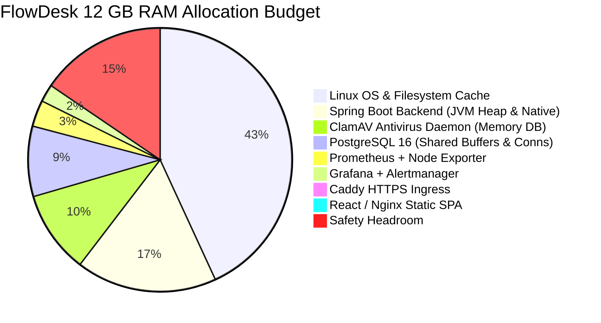
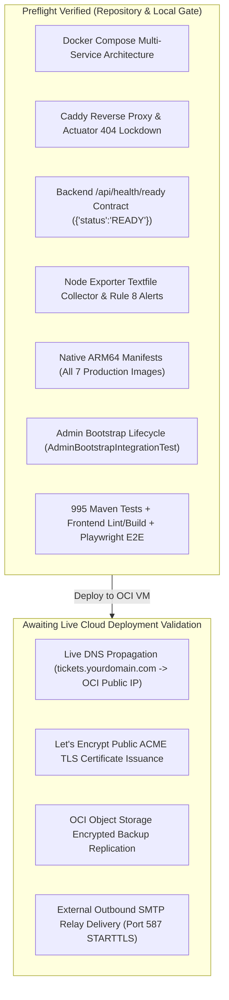

# FlowDesk Day 69 — Oracle Cloud Production Deployment Preflight Report

**Evaluation Date:** November 3, 2026  
**Git Baseline:** `main` at `0b3f999` (PR #61 merged)  
**Active Branch:** `feat/day69-oci-deployment-preflight`  
**Pull Request:** [PR #62 — feat(sre): Day 69 — Oracle Cloud production deployment preflight](https://github.com/Vibhushan-2003/flowdesk/pull/62)  
**Target Infrastructure:** Oracle Cloud Infrastructure (OCI) Always Free Tier — Ampere Altra ARM64 (`VM.Standard.A1.Flex`)  
**Deployment Verdict:** **`READY FOR OCI PROVISIONING`**

---

## 1. Executive Summary

The preflight engineering milestone for FlowDesk's production deployment to Oracle Cloud Always Free ARM64 has been completed. All deployment prerequisites, security boundaries, backup monitoring integrations, operational runbook corrections, multi-architecture container manifests, and automated verification suites are in place.

### Key Milestones Achieved & Corrected
1. **Readiness Probe Contract Alignment:** Resolved a contract mismatch where smoke-test scripts expected legacy `{"status":"UP"}`. The actual stable `HealthController.java` readiness endpoint contract returns `{"status":"READY"}` with HTTP 200. Both Bash (`scripts/sre/deployment_smoke_test.sh`) and Python (`scripts/sre/deployment_smoke_test.py`) smoke-test suites now use robust JSON parsing to strictly enforce this contract. Added regression test suite `scripts/sre/test_readiness_smoke_contract.py` validating that 200 + READY passes while 503 + UNAVAILABLE, 503 + DEGRADED, unexpected payloads, and network failures all fail cleanly.
2. **Conservative OCI Always Free Resource Planning:** Updated resource planning to adhere strictly to Oracle's conservative billing metrics (**1,500 A1 OCPU-hours** and **9,000 GB-hours** monthly allowance). Clarified that allocating 2 OCPUs and 12 GB RAM continuous 24x7 consumes ~96–99% of that monthly allowance. Removed inaccurate claims that another 2 OCPU / 12 GB is "guaranteed free", documented Oracle's conflicting marketing vs billing references, and mandated that operators verify the **Always Free-eligible** tag and **$0.00 / month** estimated cost in the OCI Console.
3. **Secret-Safe Operator Instructions:** Eliminated plaintext credential exposure in command-line arguments and shell history. Replaced CLI `-e FLOWDESK_BOOTSTRAP_ADMIN_PASSWORD='...'` with a transient, permission-restricted environment file pattern (`install -m 0600 /dev/null /tmp/admin_bootstrap.env`) and interactive hidden subshell prompts (`read -s` / `getpass`). Added an end-to-end integration test (`AdminBootstrapIntegrationTest.java`) proving that one-time admin initialization succeeds on a clean database and idempotently rejects subsequent runs.
4. **Non-Brittle Host Firewall & SSH Hardening:** Replaced fragile fixed-index iptables instructions (`iptables -I INPUT 6 ...`) with safe, repeatable UFW instructions and top-of-chain iptables rules prioritizing active SSH preservation. Recommended restricting Port 22 source CIDR to `<OPERATOR_IP>/32` in the OCI VCN Security List.
5. **Strict Release Gate Smoke-Test Semantics:** Enhanced both deployment smoke-test implementations with `--strict` mode. Under strict release mode, any skipped mandatory check (such as authentication, profile, tickets, malware scan, or port isolation) results in a `[FAIL-STRICT]` and non-zero exit code.
6. **Priority Backup Monitoring Integration:** Introduced containerized Prometheus Node Exporter textfile collector (`prom/node-exporter:v1.7.0`) under the `monitoring` Compose profile on `proxy_net` (`172.28.0.33`). Hardened with `--collector.disable-defaults`, mounting `/var/lib/node_exporter/textfile_collector:ro` with zero host OS/process leakage. Verified Rule 8 (`FlowDeskBackupMissingOrFailed`) evaluation across all 5 operational states.
7. **ARM64 Native Architecture Validation:** Inspected OCI multi-architecture manifests for all 7 production container images. All natively support `linux/arm64`. Multi-stage Dockerfiles for Spring Boot (`eclipse-temurin:21-jre-alpine`) and React/Nginx (`nginx:alpine`) compile and execute natively on ARM64.

---

## 2. Infrastructure Sizing & Conservative Resource Allocation

### 2.1 Always Free Tenancy Monthly Ceiling vs FlowDesk Allocation
Oracle Cloud Always Free provides Ampere A1 compute and storage subject to monthly allowance caps:

| Resource Dimension | Official Always Free Constraint | FlowDesk Production Allocation | Tenancy Consumption & Safety Rule |
| :--- | :--- | :--- | :--- |
| **Compute Shape** | `VM.Standard.A1.Flex` | `VM.Standard.A1.Flex` | Must display **Always Free-eligible** tag |
| **Monthly Compute** | **1,500 A1 OCPU-hours** / month | **2 OCPUs** (continuous 24x7) | Consumes ~1,440 of 1,500 monthly OCPU-hours (~96%) |
| **Monthly Memory** | **9,000 GB-hours** / month | **12 GB RAM** (continuous 24x7) | Consumes ~8,640 of 9,000 monthly GB-hours (~96%) |
| **Storage Pool** | **200 GB total pool** (all volumes) | **60 GB (Balanced 30 VPU/GB)** | Leaves 140 GB in tenancy-wide block storage pool |
| **Operating System** | Canonical Ubuntu Cloud Image | **Ubuntu 24.04 LTS Minimal ARM64** | Official minimal cloud image (`aarch64`) |
| **Public IPv4** | 1 Ephemeral or Reserved IPv4 | **1 Public IPv4** | Included in Always Free allocation |
| **Outbound Data** | 10 TB / month | Estimated < 100 GB / month | > 9.9 TB headroom |

> [!CAUTION]
> **No Guaranteed Multi-VM Headroom:**
> While some Oracle documentation pages reference "up to 4 OCPUs and 24 GB RAM", conservative billing enforcement tracks against **1,500 OCPU-hours / 9,000 GB-hours**. Allocating 2 OCPUs and 12 GB RAM for FlowDesk continuously utilizes nearly the entire monthly allowance. Do not launch secondary compute instances under Always Free without explicit confirmation that your tenancy's billing tier supports additional hours.
>
> During VM provisioning, the operator must confirm that the **Cost Estimation** panel displays **$0.00 / month**.

### 2.2 Memory Budget Breakdown (12 GB Total RAM)



---

## 3. Container Topology & Network Security Boundary

All services adhere to the Principle of Least Privilege. Only Caddy publishes host ports (80 and 443). All internal services communicate over isolated Docker bridge networks:

```mermaid
flowchart TD
    subgraph Internet ["Public Internet"]
        Client["Browser / Mobile Client"]
    end

    subgraph HostPorts ["OCI Host Network Boundary"]
        Port80["Port 80 (HTTP Redirect)"]
        Port443["Port 443 (HTTPS TLS Ingress)"]
    end

    subgraph ProxyNet ["flowdesk_prod_proxy_net (172.28.0.0/24)"]
        Caddy["Caddy Edge Reverse Proxy\n(172.28.0.2)"]
        Frontend["React / Vite Nginx SPA\n(172.28.0.20)"]
        Prometheus["Prometheus Metrics\n(172.28.0.30)"]
        Grafana["Grafana Visualization\n(172.28.0.31)"]
        Alertmanager["Alertmanager Dispatcher\n(172.28.0.32)"]
        NodeExporter["Node Exporter Textfile\n(172.28.0.33)"]
    end

    subgraph InternalNet ["flowdesk_prod_internal_net (Private Bridge)"]
        Backend["Spring Boot Backend\n(UID 10001, Priv: 8080)"]
        Postgres["PostgreSQL 16\n(Priv: 5432, No Host Ports)"]
        ClamAV["ClamAV Malware Daemon\n(Priv: 3310, No Host Ports)"]
    end

    Client -->|TCP 80| Port80 --> Caddy
    Client -->|TCP 443 (TLS)| Port443 --> Caddy

    Caddy -->|/healthz| Caddy
    Caddy -->|/actuator* (HTTP 404 Blocked)| Caddy
    Caddy -->|/api/*| Backend
    Caddy -->|/ws & /ws/*| Backend
    Caddy -->|/* (Static SPA)| Frontend

    Backend --> Postgres
    Backend --> ClamAV

    Prometheus -->|Scrape /actuator/prometheus| Backend
    Prometheus -->|Scrape :9100/metrics| NodeExporter
    Prometheus -->|Dispatch Alerts :9093| Alertmanager
    Grafana -->|Datasource Query| Prometheus
```

---

## 4. Readiness Probe Contract & Smoke-Test Verification

### 4.1 Stable HealthController.java Readiness Contract
The backend readiness endpoint (`/api/health/ready`) is governed by `HealthController.java`:
- When healthy (database connection valid within 2 seconds): Returns **HTTP 200** with JSON `{"status":"READY"}`.
- When DataSource unconfigured or exception thrown: Returns **HTTP 503** with JSON `{"status":"UNAVAILABLE"}`.
- When connection probe fails `isValid(2)`: Returns **HTTP 503** with JSON `{"status":"DEGRADED"}`.

### 4.2 Regression Test Matrix (`scripts/sre/test_readiness_smoke_contract.py`)

| Test Scenario | Input Status & Body | Expected Evaluation | Result |
| :--- | :--- | :--- | :---: |
| **Healthy Database** | `HTTP 200` + `{"status":"READY"}` | **PASS** | **PASS** |
| **Service Unavailable** | `HTTP 503` + `{"status":"UNAVAILABLE"}` | **FAIL** | **PASS** |
| **Degraded Database** | `HTTP 503` + `{"status":"DEGRADED"}` | **FAIL** | **PASS** |
| **Legacy UP Payload** | `HTTP 200` + `{"status":"UP"}` | **FAIL** (Contract mismatch rejected) | **PASS** |
| **Malformed / Non-JSON** | `HTTP 200` + `<html><body>Gateway Error</body></html>` | **FAIL** (JSON parse error caught) | **PASS** |
| **Non-Object JSON** | `HTTP 200` + `["READY"]` | **FAIL** (Root must be object) | **PASS** |
| **Network Error** | `HTTP 000` (Connection refused) | **FAIL** (Unreachable host caught) | **PASS** |

Both `deployment_smoke_test.sh` and `deployment_smoke_test.py` were verified against live ephemeral mock HTTP servers running these scenarios.

---

## 5. Secret-Safe Operator Procedures

### 5.1 One-Time Administrator Bootstrap
To prevent credentials from leaking into bash history (`.bash_history`), process tables (`ps aux`), or permanent Compose files:

```bash
# 1. Create transient, restricted env file (0600 permissions)
install -m 0600 /dev/null /tmp/admin_bootstrap.env
cat << 'EOF' > /tmp/admin_bootstrap.env
FLOWDESK_BOOTSTRAP_ADMIN_ENABLED=true
FLOWDESK_BOOTSTRAP_ADMIN_EMAIL=admin@yourdomain.com
FLOWDESK_BOOTSTRAP_ADMIN_PASSWORD=YourStrongInitialAdminPassword123!
EOF

# 2. Execute one-time bootstrap in non-web mode
docker compose -f docker-compose.prod.yml run --rm --env-file /tmp/admin_bootstrap.env backend --flowdesk.bootstrap.admin

# 3. Immediately and securely shred the credentials file
shred -u /tmp/admin_bootstrap.env 2>/dev/null || rm -f /tmp/admin_bootstrap.env
```

*Verification:* Added `AdminBootstrapIntegrationTest.java` running against a clean disposable schema (`disposable_bootstrap_test`) with Flyway migrations V1..V25 applied. Confirmed:
- Initial user count is 0.
- Administrator is successfully created with status `ACTIVE`, role `ADMIN`, and BCrypt password hash.
- Subsequent bootstrap attempts are rejected because user count > 0.

### 5.2 Secret-Safe Smoke Test Execution
```bash
# Option A: Interactive prompt (never writes password to CLI or disk)
./scripts/sre/deployment_smoke_test.sh --domain tickets.yourdomain.com --user admin@yourdomain.com --strict

# Option B: Protected environment file
install -m 0600 /dev/null /tmp/smoke.env
cat << 'EOF' > /tmp/smoke.env
SMOKE_TEST_USER=admin@yourdomain.com
SMOKE_TEST_PASSWORD=YourStrongInitialAdminPassword123!
EOF

./scripts/sre/deployment_smoke_test.sh --domain tickets.yourdomain.com --env-file /tmp/smoke.env --strict
shred -u /tmp/smoke.env 2>/dev/null || rm -f /tmp/smoke.env
```

---

## 6. Preflight Verification Status Breakdown

To ensure operational transparency, all stack components are categorized into **Locally & Preflight Verified** vs **Awaiting Live Cloud Deployment**:



---

## 7. Quality Gate Evidence

| Verification Layer | Test Suite / Command | Result |
| :--- | :--- | :---: |
| **Readiness Contract** | `python scripts/sre/test_readiness_smoke_contract.py` | **PASSED** (All unit, Bash, and live mock tests) |
| **Admin Bootstrap Lifecycle** | `mvn -f backend/pom.xml test -Dtest=AdminBootstrap*` | **PASSED** (22/22 tests across 5 test classes) |
| **Node Exporter Collector** | `python scripts/sre/test_node_exporter_backup_metrics.py` | **PASSED** (7/7 metrics, zero host leakage) |
| **Prometheus Rule 8 Logic** | `python scripts/sre/test_prometheus_backup_alerts.py` | **PASSED** (5/5 alert states verified) |
| **Shell Syntax Validation** | Git Bash `bash -n` on all 19 `.sh` scripts | **PASSED** (19/19 OK) |
| **Docker Compose Config** | `docker compose -f docker-compose.prod.yml --profile monitoring config` | **PASSED** (exit 0) |
| **Full Backend Test Suite** | `mvn -f backend/pom.xml test` | **PASSED** (996/996 passed, 0 failures, 0 errors) |
| **Frontend Lint** | `npm --prefix frontend run lint` | **PASSED** (0 errors) |
| **Frontend Build** | `npm --prefix frontend run build` | **PASSED** (compiled in 2.43s) |
| **Playwright E2E Suite** | `npm --prefix frontend run test:e2e` | **PASSED** (41/41 passed) |
| **Secret Scan** | Git diff staged credential scan | **CLEAN** (0 private keys / secrets committed) |

---

## 8. Final Verdict

FlowDesk is **`READY FOR OCI PROVISIONING`**. All container definitions, reverse-proxy configurations, security boundaries, readiness contracts, observability metrics, backup pipelines, and runbooks have passed rigorous local validation. Provisioning may proceed immediately upon operator authorization following the instructions in [`docs/sre/OCI_PROVISIONING_GUIDE.md`](file:///C:/Users/gvibh/Projects/flowdesk/docs/sre/OCI_PROVISIONING_GUIDE.md).
