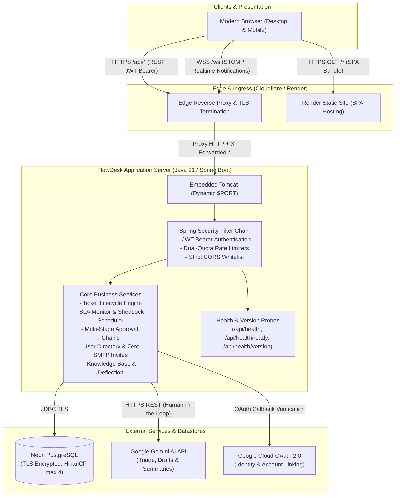
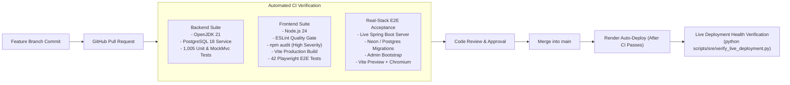

# FlowDesk — AI-Assisted IT Service Operations Platform

[](https://github.com/Vibhushan-2003/flowdesk/actions/workflows/ci.yml)
[](https://flowdesk-demo-glkr.onrender.com)
[](https://flowdesk-demo-api.onrender.com/api/health/ready)
[](https://openjdk.org/projects/jdk/21/)
[](https://spring.io/projects/spring-boot)
[](https://react.dev/)
[](https://www.typescriptlang.org/)
[-336791?style=flat&logo=postgresql)](https://neon.tech/)

**FlowDesk** is a production-grade, enterprise-ready IT service management and ticketing platform designed to streamline incident resolution, enforce SLA compliance, and accelerate support workflows with human-in-the-loop Google Gemini AI assistance.

Built as a modern distributed monolith, FlowDesk couples a high-throughput Java 21 / Spring Boot backend with a responsive, accessible React 19 / TypeScript SPA, backed by relational ACID persistence, atomic sliding-window rate limiters, fail-closed malware security, and cross-site token rotation.

---

## 🌐 Live Public Demonstration

| Component | Platform | URL | Operational Status |
|---|---|---|---|
| **Frontend SPA** | Render Static Site (CDN) | [https://flowdesk-demo-glkr.onrender.com](https://flowdesk-demo-glkr.onrender.com) | **Active** (SPA Routing Enabled) |
| **Backend REST API** | Render Free Web Service | [https://flowdesk-demo-api.onrender.com](https://flowdesk-demo-api.onrender.com) | **Active** (Tuned 512 MB cgroup) |
| **Database** | Neon Serverless PostgreSQL | TLS `sslmode=require` | **Active** (Flyway v1–v25) |
| **Liveness Health Probe** | HTTP GET `/api/health` | [https://flowdesk-demo-api.onrender.com/api/health](https://flowdesk-demo-api.onrender.com/api/health) | `200 OK: Backend is running!` |
| **Readiness Health Probe** | HTTP GET `/api/health/ready` | [https://flowdesk-demo-api.onrender.com/api/health/ready](https://flowdesk-demo-api.onrender.com/api/health/ready) | `200 OK: {"status":"READY"}` |

> [!NOTE]
> **Free-Tier Cold Starts:** On Render Free, backend web services spin down after 15 minutes of inactivity. The initial request after spin-down may take ~30–50 seconds to boot the JVM container. Subsequent requests execute with sub-50ms latency.

---

## 🏗️ Architecture Blueprint



---

## 👥 Role-Based Access Control (RBAC) Matrix

FlowDesk implements strict principle-of-least-privilege role boundaries enforced across database schemas, Spring Security method-level annotations (`@PreAuthorize`), and frontend route guards:

| Capability / Resource | Employee | Support Engineer | Team Lead | Administrator |
|---|:---:|:---:|:---:|:---:|
| **Create & View Own Tickets** | ✅ | ✅ | ✅ | ✅ |
| **Self-Service KB Deflection** | ✅ | ✅ | ✅ | ✅ |
| **Support Queue & Ticket Assignment** | ❌ | ✅ | ✅ | ✅ |
| **Post Customer Messages** | ✅ (own) | ✅ (assigned) | ✅ | ✅ |
| **Post Internal Staff Notes** | ❌ | ✅ | ✅ | ✅ |
| **Approve Stage-Gate Change Requests** | ❌ | ❌ | ✅ | ✅ |
| **SLA Dashboard & Breach Oversight** | ❌ | ✅ | ✅ | ✅ |
| **Operational Analytics & CSV Reports** | ❌ | ❌ | ✅ | ✅ |
| **Security Audit Trail Log Inspection** | ❌ | ❌ | ❌ | ✅ |
| **User Directory & Invitation Issuance** | ❌ | ❌ | ❌ | ✅ |
| **Zero-SMTP Activation Link Generation** | ❌ | ❌ | ❌ | ✅ |
| **Account Activation & Role Mutation** | ❌ | ❌ | ❌ | ✅ |

---

## ⚡ Core Engineering Highlights

### 1. Zero-SMTP Invitation Link Security
On environments where outbound SMTP is blocked by platform policy (such as Render Free blocking ports 25, 465, and 587), FlowDesk provides a secure, administrator-assisted invitation activation pathway:
- Raw invitation tokens are **never** logged, persisted in plaintext, audited, or returned on public endpoints. Only the salted SHA-256 hash is persisted in PostgreSQL.
- When an authorized administrator clicks **Resend Invitation** on the User Management dashboard, the backend verifies `app.mail.enabled=false` and returns the newly generated activation link in `ResendInvitationResponse.invitationUrl`.
- In email-enabled production environments, `invitationUrl` remains strictly `null` and is completely omitted from the JSON payload via `@JsonInclude(NON_NULL)`.
- The user visits `/accept-invitation?token=...` to either establish their password or seamlessly link their Google OAuth identity in a single transaction.

### 2. Gemini AI Assistance with Human-in-the-Loop Guardrails
FlowDesk integrates Google's Gemini Flash AI model to accelerate support operations while enforcing strict safety boundaries:
- **Triage Assistance:** Analyzes ticket description text to recommend priority (CRITICAL, HIGH, MEDIUM, LOW) and categorical tags.
- **Smart Reply Drafts:** Formulates customer-facing response suggestions referencing related Knowledge Base articles.
- **Resolution Summaries:** Generates concise technical post-mortems when resolving multi-step incidents.
- **Human-in-the-Loop Safeguard:** AI suggestions are purely assistive. The system **never** auto-applies priority changes, automatically publishes replies, or modifies ticket status without explicit engineer review and confirmation.

### 3. Fail-Closed Malware Protection Architecture
- Under full production deployment (OCI / Docker Compose), attachments stream directly through ClamAV via the native TCP `INSTREAM` protocol with memory-bounded chunking and EICAR detection.
- Under Render Free constraints (where running ClamAV's >1.2 GB daemon exceeds the 512 MB cgroup memory cap), FlowDesk activates a **fail-closed security guard**: attachment uploads return HTTP 503 Service Unavailable rather than bypassing malware inspection or using insecure mock scanners.
- Actuator health indicators and Micrometer metrics for ClamAV are conditionally decoupled (`@ConditionalOnProperty`) in demo mode to prevent false-negative 503 health responses.

### 4. Sliding-Window Rate Limiting
- Defense-in-depth protection against brute-force credential stuffing and denial of service.
- Implements synchronized dual-quota sliding-window tracking:
  - **Per-IP Quota:** Defaults to 30 requests per 60 seconds.
  - **Per-IP+Email Quota:** Defaults to 5 requests per 300 seconds.
- Integrated via `ClientIpResolver` with RFC1918 trusted-proxy reverse validation to eliminate `X-Forwarded-For` header spoofing.
- Rejects oversized payloads (>8 KB) with HTTP 413 Payload Too Large before allocating JSON parser memory buffers.

---

## 🧪 Comprehensive Verification & Test Metrics

FlowDesk maintains an exhaustive test harness executed continuously on every pull request and push to `main`:

```
========================================================================
Test Execution Summary (Clean Build Verification)
========================================================================
Backend Unit & Integration Tests:     1,005 passed (0 failed, 1 skipped)
Playwright E2E User Journeys:            42 passed (0 failed)
ESLint Code Quality Verification:         0 errors, 0 warnings
Frontend TypeScript & Vite Build:      Clean production bundle
Dependency Security Audit:                0 high/critical vulnerabilities
Readiness Probe Contract Tests:          17 passed (0 failed)
Live Deployment Verification:             9 passed (0 failed)
========================================================================
```

---

## 🚀 CI/CD Pipeline & Deployment Strategy

FlowDesk utilizes GitHub Actions for automated quality gates and Render for continuous deployment:



---

## 💻 Local Development Quickstart

### Prerequisites
- **Java 21** (Eclipse Temurin recommended)
- **Node.js 22+** and **npm**
- **Docker** and **Docker Compose**
- **Maven 3.9+**

### 1. Clone & Set Up Environment
```bash
git clone https://github.com/Vibhushan-2003/flowdesk.git
cd flowdesk

# Configure local development environment variables
cp .env.example .env
```

### 2. Start Supporting Infrastructure
```bash
# Boot PostgreSQL and Mailpit
docker compose up -d postgres mailpit
```

### 3. Run Backend (Spring Boot)
```bash
cd backend
mvn spring-boot:run
# Backend initializes at http://localhost:8080
```

### 4. Run Frontend (Vite SPA)
```bash
cd ../frontend
npm install
npm run dev
# Frontend initializes at http://localhost:5173
```

---

## 🛡️ Disaster Recovery & Rollback Runbook

### Rollback Procedure
1. **GitHub Main Branch:**
   ```bash
   git revert <commit-sha> -m "revert: rollback due to operational incident"
   git push origin main
   ```
2. **Render Automatic Rollback:**
   - Render detects the push to `main` and automatically redeploys the previous stable state.
   - To immediately rollback without a Git push, navigate to the Render Dashboard, select `flowdesk-demo-api` or `flowdesk-demo-glkr`, click **Deploys**, and select **Rollback to this deploy**.
3. **Database Schema Continuity:**
   - All Flyway migrations (v1 through v25) are written with forward/backward compatibility guarantees. Schema alterations avoid destructive column deletions.

---

## 📄 License & Attribution

This project is open-source under the [MIT License](LICENSE). Developed by [Vibhushan-2003](https://github.com/Vibhushan-2003) as a professional software engineering showcase.
