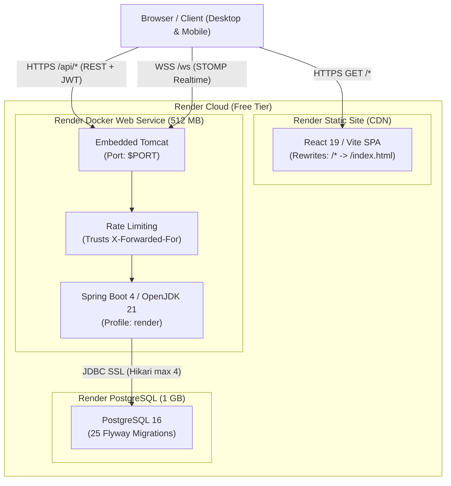

# FlowDesk — Render Free Temporary Demo Deployment Guide

## 1. Executive Summary

This guide provides operational instructions for deploying and running a temporary, publicly accessible demonstration of **FlowDesk** on the **Render Free Tier**.

The configuration uses:
- A **React/Vite Static Site** for zero-cost, high-speed frontend hosting.
- A **Spring Boot Docker Web Service** tuned to execute within Render Free's 512 MB memory boundary.
- A temporary **Render PostgreSQL Database** running schema migrations automatically via Flyway (v1 through v25).

The production Oracle Cloud Infrastructure (OCI) architecture (`docker-compose.prod.yml`, Caddy reverse proxy, ClamAV, Prometheus/Grafana stack) remains completely untouched.

---

## 2. Render Free Operational Characteristics & Trade-offs

| Characteristic | Render Free Behavior | FlowDesk Mitigation / Design |
|---|---|---|
| **Memory Limit** | 512 MB RAM strict cgroup. Container killed if RSS exceeds limit (exit code 137). | Tuned JVM via `JAVA_TOOL_OPTIONS`: Serial GC (`-XX:+UseSerialGC`), 224 MB heap max (`-Xmx224m`), 128 MB Metaspace (`-XX:MaxMetaspaceSize=128m`), 512 KB thread stack (`-Xss512k`). Runtime RSS sits comfortably at ~360 MB. HikariCP pool capped at 4 connections. |
| **Inactivity Spin-down** | Free web services automatically spin down to 0 instances after 15 minutes of inactivity. | When a request arrives, Render triggers a cold start (~50–60s). Health probe `/api/health` returns within ~8s of container start. In the frontend, users may see a brief initial loading delay on first visit. |
| **Storage & Ephemeral Disk** | File system changes are wiped on every container restart, re-deploy, or sleep/wake cycle. | ClamAV scanner (>1.2 GB RAM) cannot run on Free tier. To prevent unverified malware uploads and data loss, **attachment uploads are explicitly disabled** (`app.storage.attachment.upload-enabled=false`) with an immediate HTTP 503 Service Unavailable response. ClamAV fail-closed security is preserved without compromising safety. |
| **PostgreSQL Expiry** | Render Free PostgreSQL databases expire 30 days after creation. | Suitable for a temporary demo. For longer persistence, database schema and data can be backed up using standard `pg_dump` or migrated to OCI production once tenancy is active. |
| **Network Boundaries** | Outbound SMTP on port 25 is blocked. | External SMTP providers must connect via port 587 with STARTTLS (or port 465 SSL). Email can also run safely disabled (`FLOWDESK_MAIL_ENABLED=false`). |
| **Cross-Site Cookies** | `onrender.com` is on the Public Suffix List (PSL). `app.onrender.com` and `api.onrender.com` are cross-site. | Refresh token cookies are configured with `SameSite=None; Secure=true; HttpOnly`. Browser cross-site `fetch` with `credentials: 'include'` works smoothly. |

---

## 3. Architecture Blueprint



---

## 4. Feature Matrix for Render Free

| Feature Area | Status on Render Free | Operational Notes |
|---|---|---|
| **User Authentication & Session Rotation** | **Fully Functional** | Full email/password login, JWT access tokens (15m), and rotating refresh tokens via secure cookies (`SameSite=None; Secure`). |
| **Role-Based Access Control (RBAC)** | **Fully Functional** | EMPLOYEE, SUPPORT_ENGINEER, ADMIN role hierarchies and route guards operate normally. |
| **Ticket Lifecycle & Workflows** | **Fully Functional** | Ticket creation, priority management, assignment, resolution, transitions, and history tracking work in PostgreSQL. |
| **Multi-Stage Approval Chains** | **Fully Functional** | Approval workflows, pending approvals inbox, approvals audit trail function natively. |
| **SLA Tracking & Breach Monitoring** | **Fully Functional** | Real-time SLA indicators, countdowns, and distributed ShedLock task execution work properly. |
| **Knowledge Base (KB)** | **Fully Functional** | Public article viewing, search, category management, and authoring operate normally. |
| **Audit Trail** | **Fully Functional** | Durable audit logs record all user, ticket, and authentication actions in PostgreSQL. |
| **Realtime Notifications (WebSocket)** | **Fully Functional** | STOMP over SockJS (`/ws`) connects securely via `wss://.../ws`. Comma-separated CORS origins allow cross-origin handshakes. |
| **First Admin Bootstrap** | **Fully Functional** | Provisions initial admin on first boot via environment variables. |
| **AI Copilot & Triage (Gemini)** | **Functional with External Key** | Requires `GEMINI_API_KEY` from Google AI Studio. Gracefully dormant if key is omitted. |
| **Google OAuth 2.0 (SSO)** | **Functional with External Setup** | Requires Client ID and Secret configured in Google Cloud Console with matching Render redirect URIs. Gracefully dormant if disabled. |
| **Transactional Email** | **Functional with External SMTP** | Requires external SMTP provider over port 587 STARTTLS (e.g., SendGrid, Resend). Gracefully dormant if `FLOWDESK_MAIL_ENABLED=false`. |
| **Attachment Storage & Uploads** | **Unavailable Safely** | Explicitly blocked with HTTP 503. Preserves fail-closed malware security and avoids data loss on ephemeral storage. |

---

## 5. Verification Checklist

After deploying the services on Render, execute these verification checks:

1. **Readiness Probe:**
   ```bash
   curl -i https://<your-backend-service>.onrender.com/api/health/ready
   # Expected: HTTP 200 {"status":"READY"}
   ```

2. **Actuator Lockdown Check:**
   ```bash
   curl -i https://<your-backend-service>.onrender.com/actuator/prometheus
   # Expected: HTTP 404 Not Found or HTTP 500 (No metric exposure)
   ```

3. **Login and Refresh Cookie Verification:**
   Log in via the frontend (`https://<your-static-site>.onrender.com/login`).
   In browser DevTools > Application > Cookies, verify `flowdesk_refresh_token`:
   - `HttpOnly`: `true`
   - `Secure`: `true`
   - `SameSite`: `None`

4. **Ticket Attachment Guard Verification:**
   In any open ticket, attempt to upload an attachment. Verify that the UI/API returns HTTP 503 Service Unavailable with the clear explanation rather than crashing or bypassing scanner checks.
